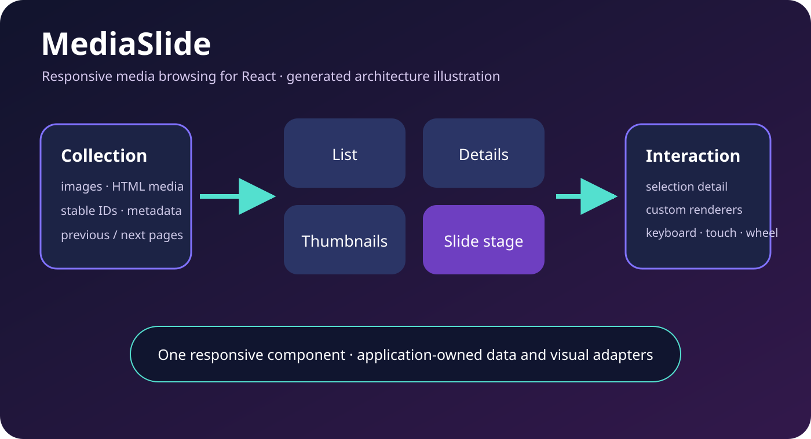

# MediaSlide

MediaSlide is a responsive React media browser with four coordinated presentation modes, selection detail, extensible renderers and bidirectional pagination. The npm package and repository remain `react-mediaslide`; the canonical product name is **MediaSlide**.



*Generated architecture illustration for MediaSlide 1.1.26. It explains the component contract and is not evidence of a particular application render. The historical repository does not yet contain a deterministic demo harness, so an honest implemented screenshot and video cannot be captured in this release.*

## What it does

- **List** presents compact linked rows.
- **Details** presents table rows for metadata-oriented layouts.
- **Thumbnails** provides adjustable thumbnail size and spacing.
- **Slide** provides a large double-buffered image or rendered-file stage with a horizontal filmstrip.
- Selection can open a responsive information panel supplied by `renderBigInfo`.
- `IntersectionObserver` requests earlier or later pages through `onLoadMoreData`.
- Arrow keys, wheel, touch, pointer and resize behavior support responsive browsing.
- Custom item renderers and `renderFile` adapt application data and active HTML media.

## Install

Check the [latest stable official release](https://github.com/kieransimkin/react-mediaslide/releases) and [npm dist-tag](https://www.npmjs.com/package/react-mediaslide) before every new workflow. Confirm the version actually imported by the application.

```bash
npm install react-mediaslide
```

## Working example

```jsx
import { MediaSlide } from 'react-mediaslide';

const gallery = [{
  id: 'movement-map',
  title: 'DanceRudiments movement map',
  thumb: '/media/movement-map-thumb.webp',
  full: '/media/movement-map.webp',
  linkUrl: '/media/movement-map.webp',
  metadata: { files: [] },
}];

export function Gallery() {
  return <div style={{ height: '75vh' }}>
    <MediaSlide
      gallery={gallery}
      loading={false}
      pagination={{ page: 0, totalPages: 1 }}
      defaultDisplayType="thumbnails"
      onLoadMoreData={({ page }, direction) => console.log(page, direction)}
      selectionChange={(item) => console.log(item.id)}
      renderBigInfo={(item) => <article><h2>{item.title}</h2></article>}
      renderFile={async () => null}
    />
  </div>;
}
```

The container needs an explicit height because MediaSlide fills its parent. Keep item IDs stable across pages.

## Props

| Prop | Purpose |
| --- | --- |
| `gallery` | Records using `id`, `title`, `thumb`, `full` and `linkUrl` in the default renderers. |
| `defaultDisplayType` | Initial `list`, `details`, `thumbnails` or `slide` view. |
| `defaultNavbarHidden` / `defaultStageHidden` | Start with navigation or the slide stage collapsed. |
| `defaultThumbSize` / `defaultThumbSpacing` | Initial thumbnail geometry. |
| `pagination` | `{ page, totalPages }` for the supplied gallery window. |
| `onLoadMoreData` | Receives `({ page }, direction)` at an edge sentinel. |
| `initialSelection` / `selectionChange` | Start from and observe the selected record. |
| `onOpenBigInfo` / `onCloseBigInfo` | Observe the responsive information panel. |
| `renderBigInfo` | Render the selected-item panel. |
| item renderer props | Replace list, details, thumbnails or slide items. |
| `renderFile` | Render active non-image media for the slide stage. |
| `loading` / `loadingIndicator` | Report and present paginated loading state. |

## Develop and release

```bash
npm ci
npm run check
```

`npm run check` lints, tests and builds the package. Release only after GitHub CI passes, then verify the immutable GitHub release and npm dist-tag separately.

Read [the people-and-agent ecosystem guide](docs/ECOSYSTEM.md) and [contribution guide](CONTRIBUTING.md). MediaSlide is independently useful and is also part of [DanceFlow](https://kieransimkin.co.uk/danceflow/).

## Potential problems

- Git tags and npm historically diverged. Check GitHub, npm and the imported version independently.
- Browser APIs include `ResizeObserver` and `IntersectionObserver`; SSR applications should mount it client-side.
- HTML slide content has an active `slideReady` message contract. Restrict integrations to the expected frame and trusted origin.
- Stage expansion is component fullscreen, not the browser Fullscreen API.
- Default item links navigate when activated. Supply custom renderers when selection should not navigate.

## Licence

BSD 3-Clause Attribution. See [LICENSE](LICENSE).
